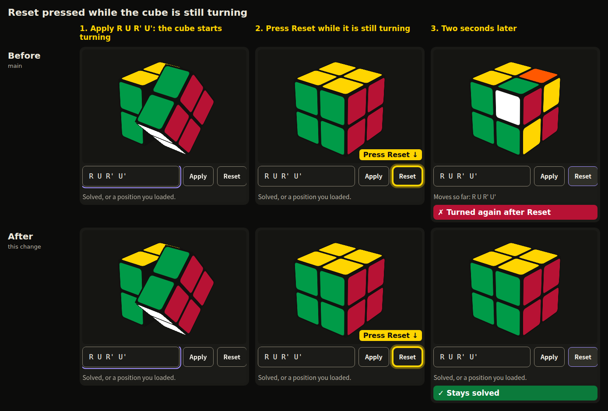
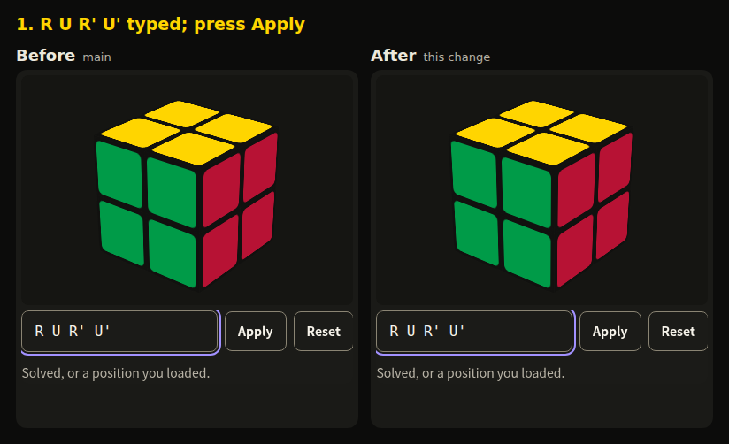
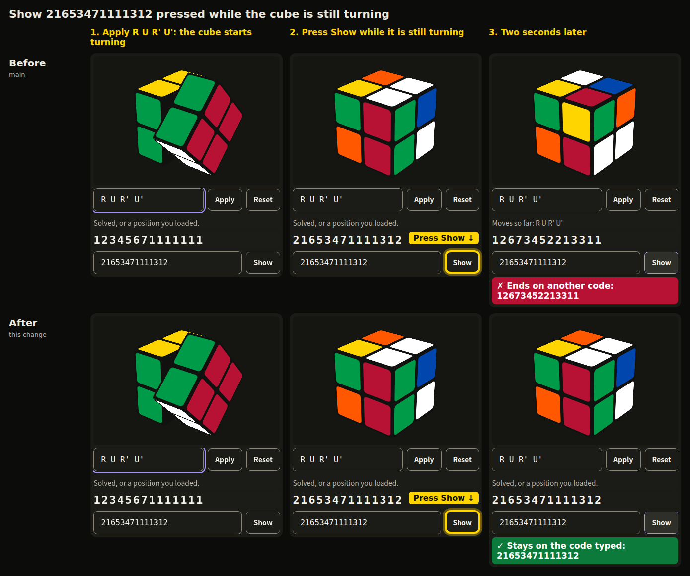

# Cube Reset and Show captures

The captures come from Chromium 156 at a 1280x1000 window on 3bbbcf5 (main,
before) and c4797e5 (this change, after), in the task-workspace browser test
harness with its stub task agent, camera and face detector and the cube
explainer turned on. Each run types R U R' U', presses Apply, and clicks Reset
or Show with the mouse about 0.1 s later, while the first turn is still
swinging, then takes a screenshot every 50 to 100 ms for 2.3 s. Each cell is
cut from those screenshots: the cube, the algorithm row and the history line,
and for Show also the position code and the Show row. The step headings, the
highlight on the pressed button and the verdicts are added by the script that
lays the cells out; nothing on the page itself was changed. The animation is an
APNG.
