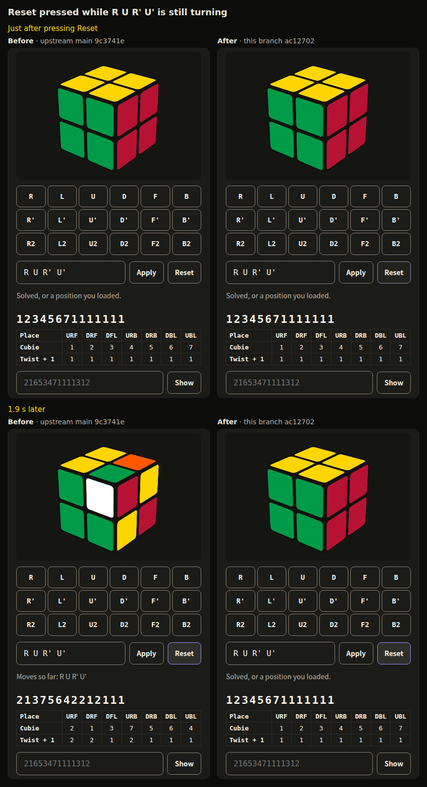
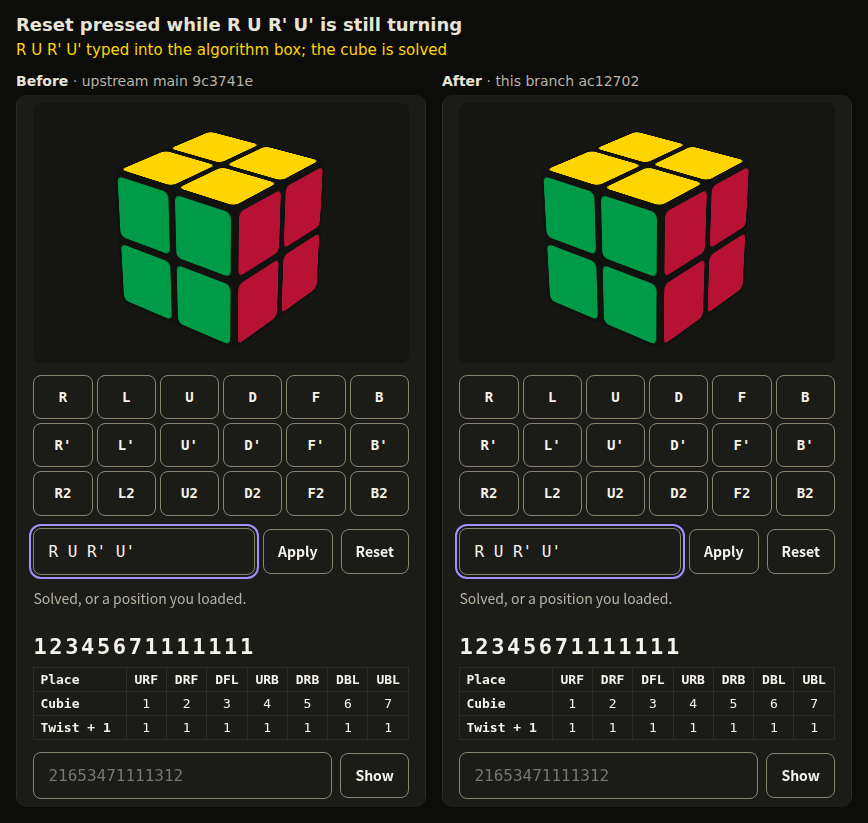
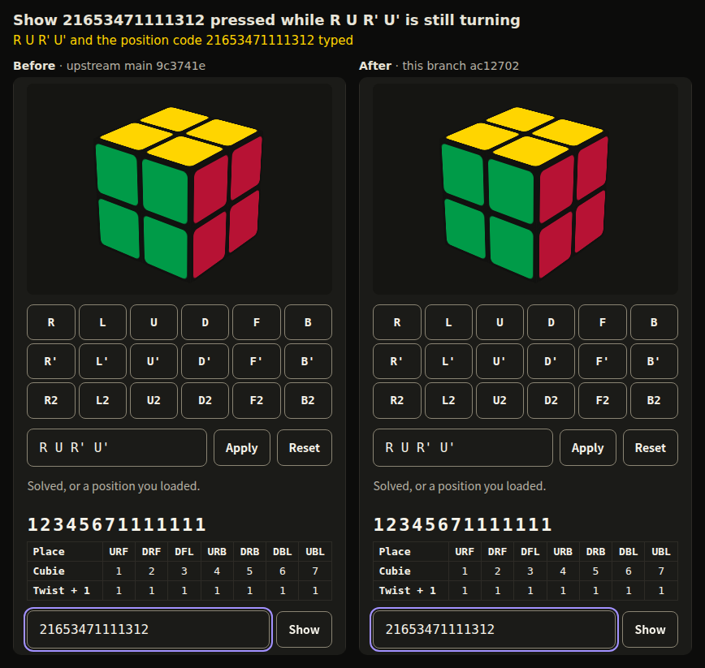

# Cube Reset and Show captures

The captures come from Chromium at a 1280x1000 window, cropped to the cube
explainer, on 9c3741e (before) and ac12702 (after). They are taken in the
task-workspace browser test harness, with its stub task agent, camera and face
detector and the cube explainer turned on. Each run types R U R' U', presses
Apply, and clicks Reset or Show with the mouse 0.08 to 0.15 s later, while the
first turn is still swinging, then takes a screenshot every 50 to 100 ms for
2.3 s. A script lays the screenshots side by side, adds the captions and builds
the animations, which are APNG files at 0.1 s a frame; nothing on the page
itself was changed.
