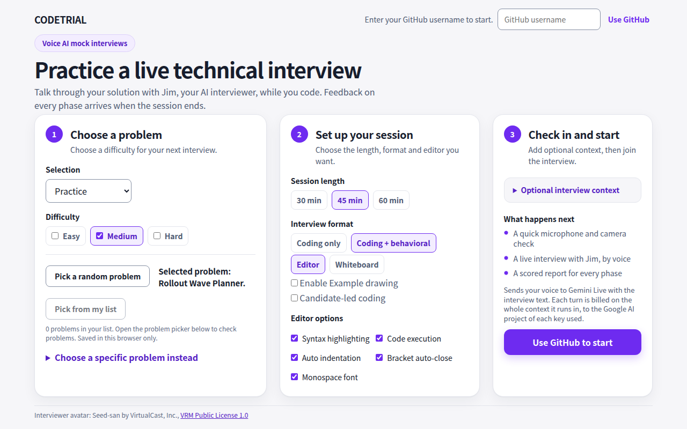
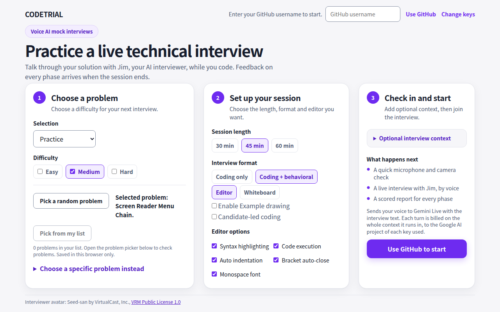
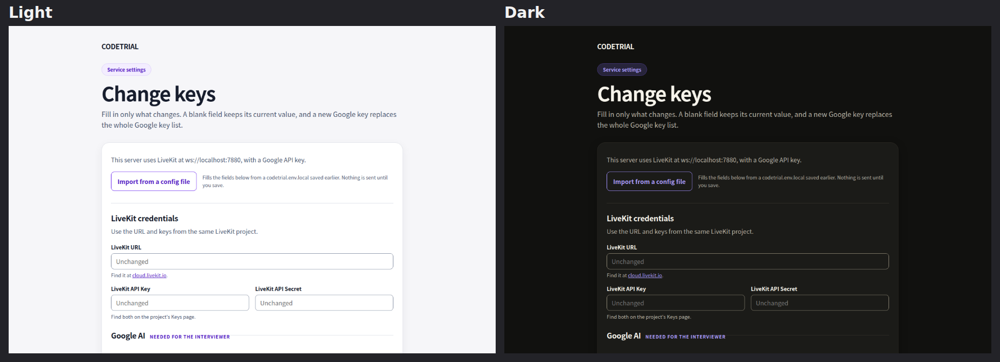
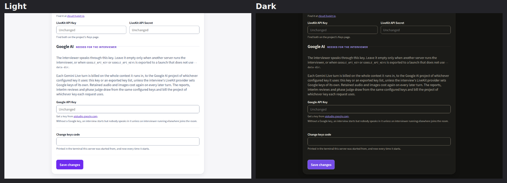
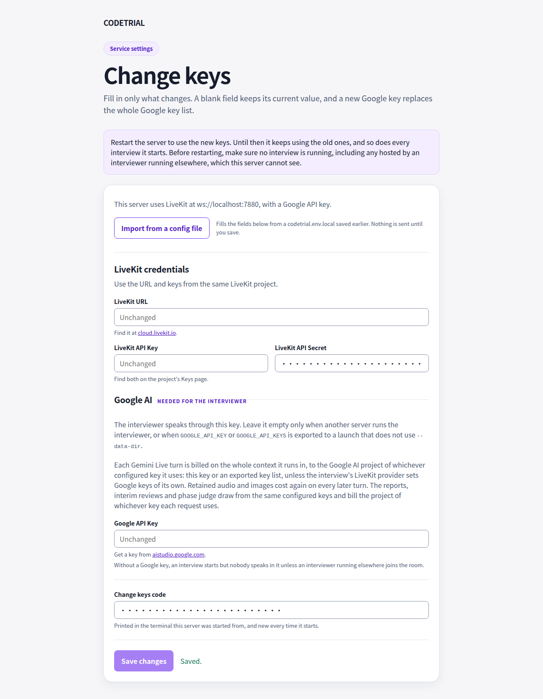

# Change keys screenshots

The screenshots come from Chromium at a 1280x860 window, light and dark from
the system scheme, on standalone loopback launches of 38d53a7 (before) and
2fed302 (after). LiveKit points at a stub at ws://localhost:7880 and every key
is made up; the lobby's random problem is seeded so the panels match.
First-time Setup renders byte-identical before and after in both schemes, so
it is not shown.
