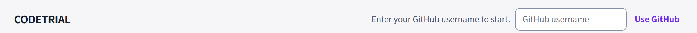
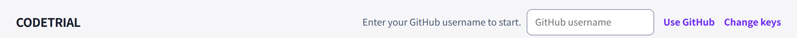
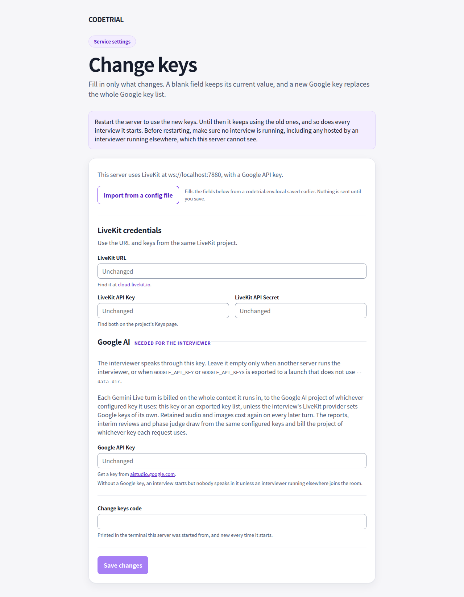
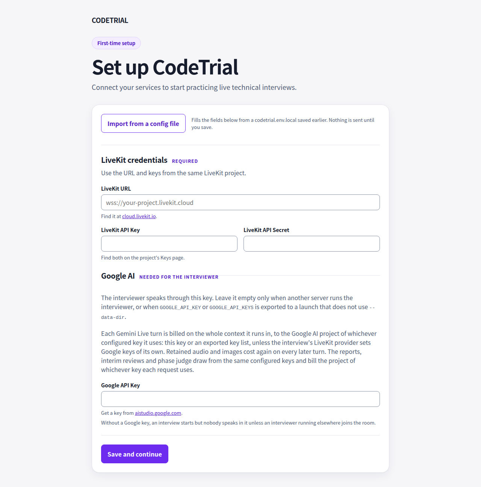

# Change keys screenshots

Screenshots for "Reopen Setup for local web credential changes". Before is
upstream main at 38d53a7 and after is 2fed302, both taken in Chromium at
1280x800 on a standalone loopback launch.

Every value on these pages is a fixture: LiveKit points at
`ws://localhost:7880`, a stub that answers `ListRooms`, and the keys and the
code the server prints are made up. No GitHub account is signed in.

## Lobby header

The Change keys link is new. It appears only on a standalone loopback launch
without trusted proxies, and never in the desktop app.

| Before                                              | After                                             |
| --------------------------------------------------- | ------------------------------------------------- |
|  |  |

## `/setup` on a configured server

Before, it answers with the lobby. After, it shows Change keys, with the
LiveKit endpoint and whether a Google key is set, never a key.

| Before                                 | After                                |
| -------------------------------------- | ------------------------------------ |
|  |  |

## After a save

The restart notice appears and Save stays disabled. Reloading the page shows
the same until the server restarts.

| Just saved                           | Reloaded                                        |
| ------------------------------------ | ----------------------------------------------- |
|  |  |

## First-time Setup

Unchanged: `img/before-first-time-setup.png` and
`img/after-first-time-setup.png` are the same file.

## Whole lobby

The selected problem is picked at random, so it differs between the two.

| Before                                | After                               |
| ------------------------------------- | ----------------------------------- |
|  |  |
